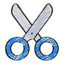

# Ben Mazzarol

I build small .NET libraries and tools that solve problems I ran into.
Each project below is its own repository, documented with
[docfx](https://dotnet.github.io/docfx/) and published to GitHub Pages on this
domain.

They share the same conventions: one idea per project, a short getting-started
page, worked examples, and an API reference generated from the source.

## Projects

-  **[Bunsen Burner](https://bmazzarol.github.io/Bunsen-Burner/)** — arrange/act/assert testing in plain C#, with automatic disposal of everything the arrange step creates.
-  **[Cutout](https://bmazzarol.github.io/Cutout/)** — source-generated templating for .NET: emit correctly indented code from a source generator without building strings by hand.
-  **[Eon](https://bmazzarol.github.io/Eon/)** — a `Schedule` type for C# that encodes "run this every 15 minutes" as data you can test.
-  **[Http BuildR](https://bmazzarol.github.io/Http-BuildR/)** — request and response builders built on the standard library only: no framework, no extra allocations.
-  **[Icicle](https://bmazzarol.github.io/Icicle/)** — structured concurrency for C#: a group of related tasks behaves as one unit of work.
-  **[Tuxedo](https://bmazzarol.github.io/Tuxedo/)** — a source generator that turns predicates into refined types, with no runtime dependency.
-  **[Pasted](https://bmazzarol.github.io/Pasted/)** — embed text files (HTML, CSS, JavaScript) into C# source at compile time.
-  **[Polyglot Notebook docfx Plugin](https://bmazzarol.github.io/Polyglot.Notebook.Docfx.Plugin/)** — turn Polyglot notebook cells into docfx pages, so examples stay executable.
-  **[docfx result snippets](https://bmazzarol.github.io/docfx.result-snippets/)** — show the executed output of a snippet inside a docfx page, with a downloadable copy.
-  **[Quacker](https://github.com/bmazzarol/Quacker)** — compile-time duck typing for C#: call a member on a type you do not have yet.

## Writing documentation

- [Documentation style guide](articles/documentation-style-guide.md) — the voice, structure and checks every page is held to.
- [The theme](articles/theme.md) — how the sites are styled, and how a change is previewed before it ships.

## Elsewhere

- [GitHub](https://github.com/bmazzarol)
- [NuGet](https://www.nuget.org/packages?q=benmazzarol)
- [SonarCloud](https://sonarcloud.io/organizations/bmazzarol)
